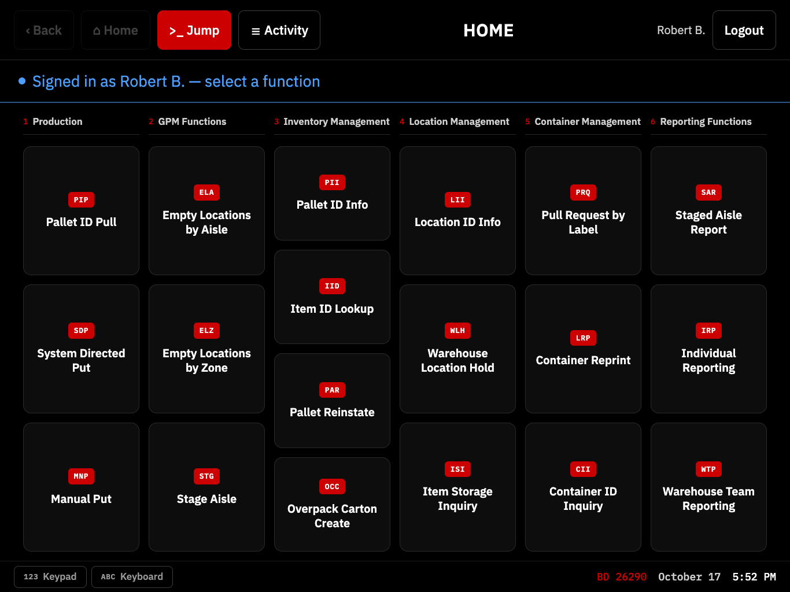
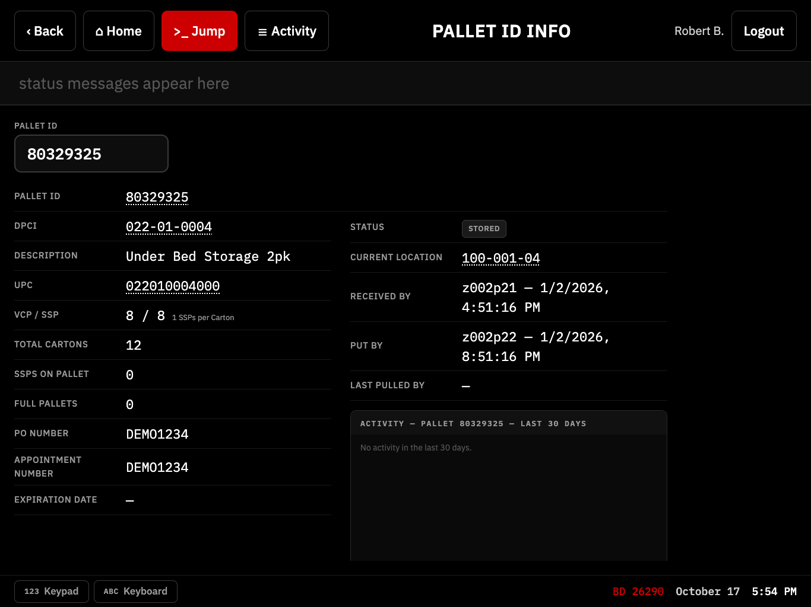
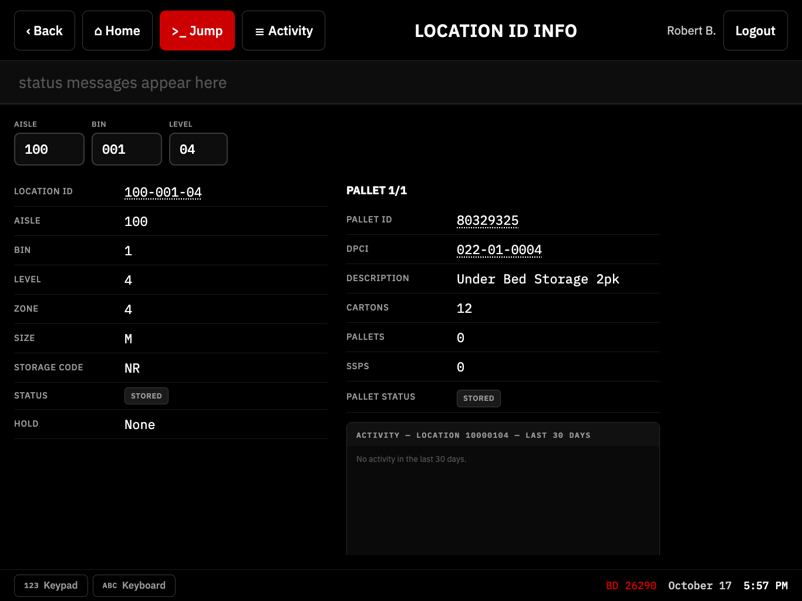
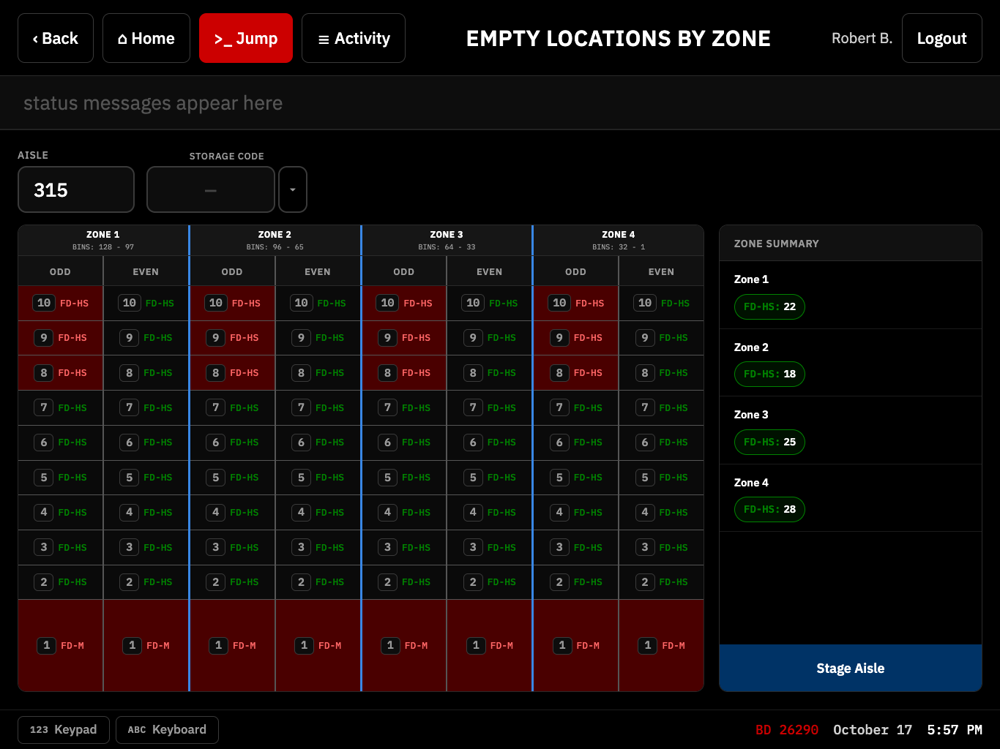
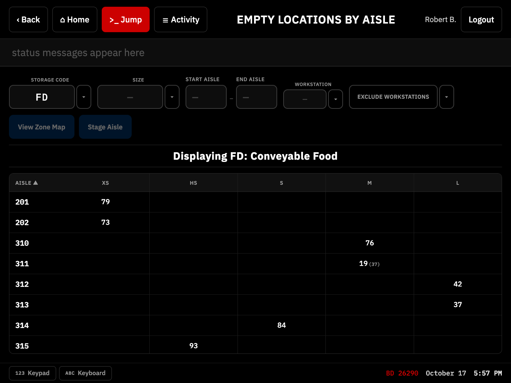
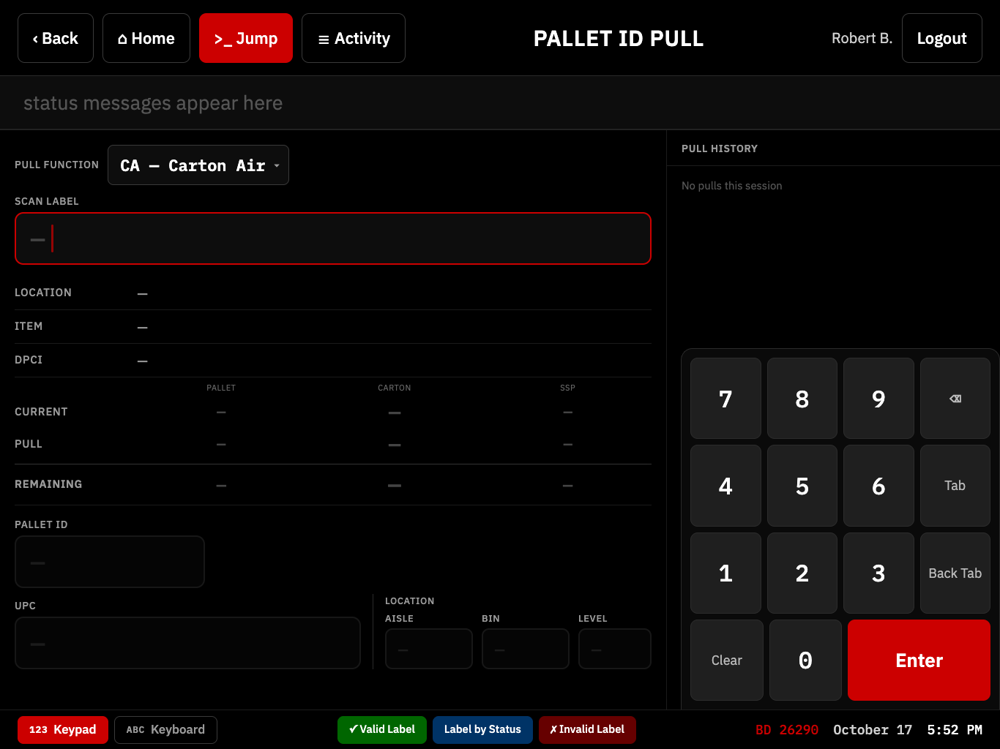
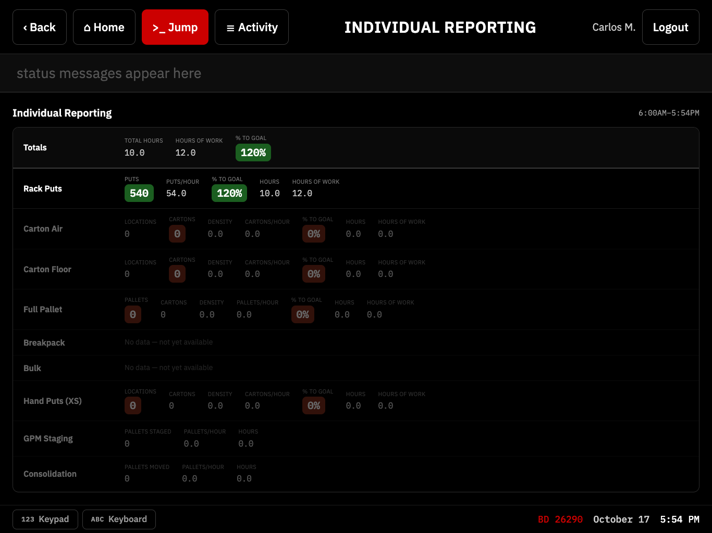
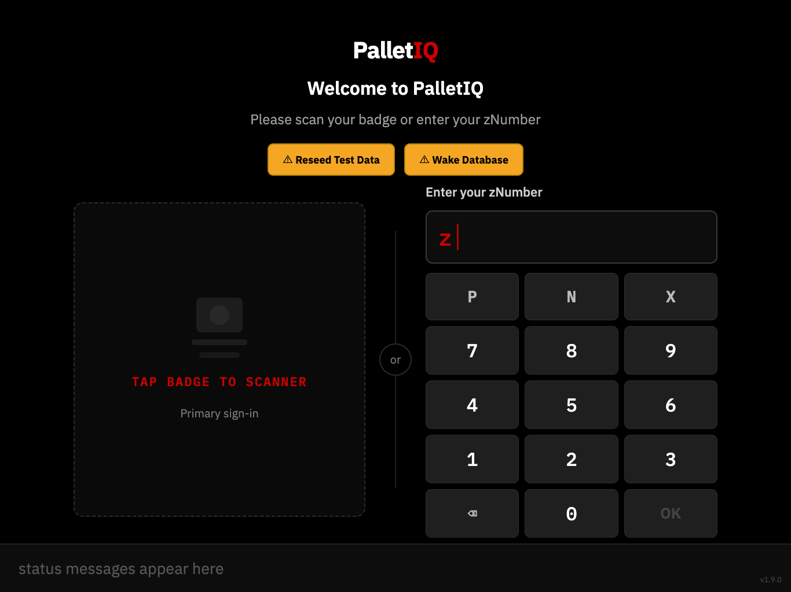

# PalletIQ

A warehouse inventory/pallet-tracking system, built as a portfolio piece from 20 years of real warehouse operations and retail management experience — see [`apps/floor-app/README.md`](apps/floor-app/README.md) for the full story of why this exists and what it does.

## Screenshots

*The floor app running against seeded demo data, at the 1366×1024 tablet resolution it's built for.*



| Pallet ID Info: every field of a pallet, with tappable links | Location ID Info: what's stored at a location |
|---|---|
|  |  |
| **Empty Locations by Zone: a visual aisle map for staging** | **Empty Locations by Aisle: open slots by storage code and size** |
|  |  |
| **Pallet ID Pull: on-screen numpad, scan-first input** | **Individual Reporting: a worker's productivity against goal** |
|  |  |
| **Login: badge scan or zNumber + PIN** | |
|  | |

This repository is a **monorepo of independently-versioned pieces**, each with its own `package.json` and `CHANGELOG.md`:

| Piece | What it is | Own docs |
|---|---|---|
| [`api/`](api/) | Shared backend — Express + Prisma/MySQL, used by both apps below | [`api/CHANGELOG.md`](api/CHANGELOG.md) |
| [`apps/floor-app/`](apps/floor-app/) | The original PalletIQ app — runs on the SYMBOL tablet | [`apps/floor-app/README.md`](apps/floor-app/README.md), [`apps/floor-app/CHANGELOG.md`](apps/floor-app/CHANGELOG.md) |
| [`apps/desktop-app/`](apps/desktop-app/) | Manager-facing desktop app (Electron), covering DPCI/Location Setup, Job/Function Assignment, Team Prod Summary, and more — **scaffold only so far** | [`apps/desktop-app/README.md`](apps/desktop-app/README.md), [`apps/desktop-app/CHANGELOG.md`](apps/desktop-app/CHANGELOG.md) |

`shared/` (repo root) holds TypeScript types and constants imported by all three — a `Pallet` or a `Location` is defined once, so a data-shape change is a compile error everywhere it's used, not a runtime surprise.

## Database query failing unexpectedly?

This project migrated off Azure SQL Server to a self-hosted MySQL instance (see GitHub #139). Check [`Documentation/Flowcharts-ERDs/database.mmd`](Documentation/Flowcharts-ERDs/database.mmd)'s "TROUBLESHOOTING" comment block first — a checklist for whether something didn't carry over correctly in that engine switch, before assuming the query logic itself is wrong.

## Where things live

- **Functional spec, screen specs, ERDs:** [`Documentation/`](Documentation/) — currently floor-app-focused (the desktop app's design docs live separately, see below), shared across the monorepo the same way `shared/` and `DevNotes/` are.
- **Design docs / dev session logs:** [`DevNotes/`](DevNotes/) — `DevNotes/DesignPrompts/Desktop/` and `DevNotes/Logs/Desktop/` hold the desktop app's own design history; everything else there is the floor-app/API's.
- **GitHub Issues** track all bugs and feature work — see each app's own `README.md` for how issues are organized for that piece.

## Getting started

Each piece installs and runs independently from its own folder:

```
cd apps/floor-app && npm install && npm run dev     # floor app (Vite dev server)
cd api && npm install && npm start                   # backend (Express, auto-restarts on save)
cd apps/desktop-app                                  # desktop app — scaffold only, nothing to run yet
```

See each folder's own `README.md`/`package.json` for the full set of scripts.
