# PalletIQ Desktop

**Status:** Electron shell, zNumber + password login, the Embedded Floor App (#141), the
Audit Tool (#148), Location Setup (#143), Job/Function Assignment (#145), Prod Goal / Ramping /
Daily Plan (#146) and Team Prod Summary (#147) are built. DPCI Setup Edit (#142) and Hung
Pallet/Location Resolution (#144) are stubbed as "Coming Soon".

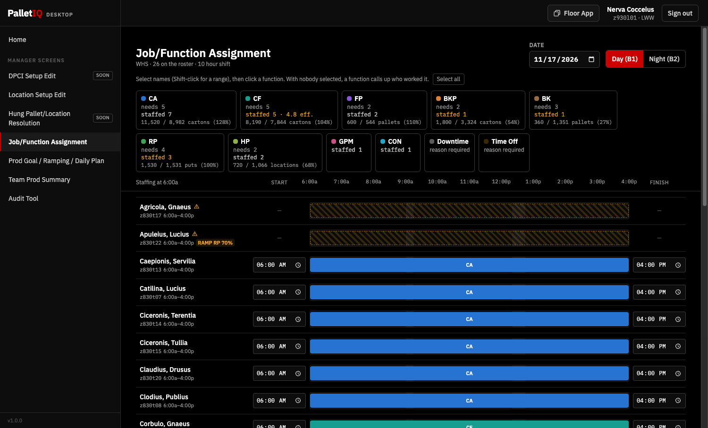

*More screenshots [below](#screenshots).*

The Manager-facing desktop application: a web app bundled with Electron, covering the
DESKTOP-bucket screens designed in the 2026-07-25 design session (DPCI Setup Edit,
Embedded Floor App, Hung Pallet/Location Resolution, Job/Function Assignment, Location
Setup Edit, Prod Goal/Ramping Override/Daily Plan, Team Prod Summary, Universal Audit
Tool).

This folder is versioned and changelogged **independently** from the other apps in this
monorepo — see [`CHANGELOG.md`](CHANGELOG.md) for this app's own history,
[`../floor-app/CHANGELOG.md`](../floor-app/CHANGELOG.md) for the floor-app's (the
tablet/SYMBOL build), and [`../../api/CHANGELOG.md`](../../api/CHANGELOG.md) for the
shared backend's. All three share the same `../../api` (Azure Functions backend +
Prisma/MySQL database) and `../../shared` (TypeScript types) at the repo root — this
folder only holds the desktop-specific frontend.

## Screenshots

Taken from the built app against the seeded demo data (Roman roster; a lead, `z930l01`,
except New aisle, which needs an OM). Retake them after a visible change — see
`Documentation/screenshots/desktop/`.

| **Job/Function Assignment: the shift roster as a timeline, staffing vs plan in the header** | **Team Prod Summary: live production against plan, by function** |
|---|---|
|  | 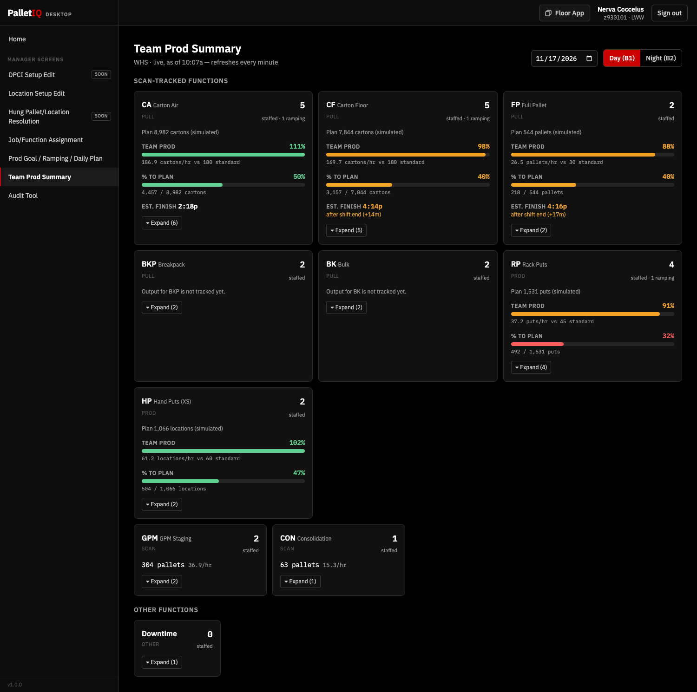 |
| **Team Prod Summary: Carton Air expanded — workers ranked by % to their (ramping-adjusted) goal** | |
| 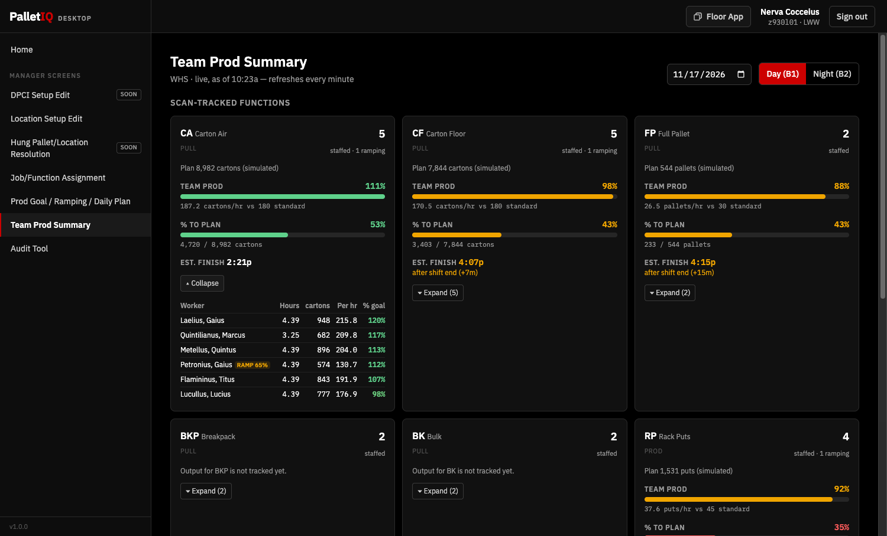 | |
| **Location Setup: zone cells edited on the aisle grid** | **Location Setup: contraction presets (here, all top locations)** |
| 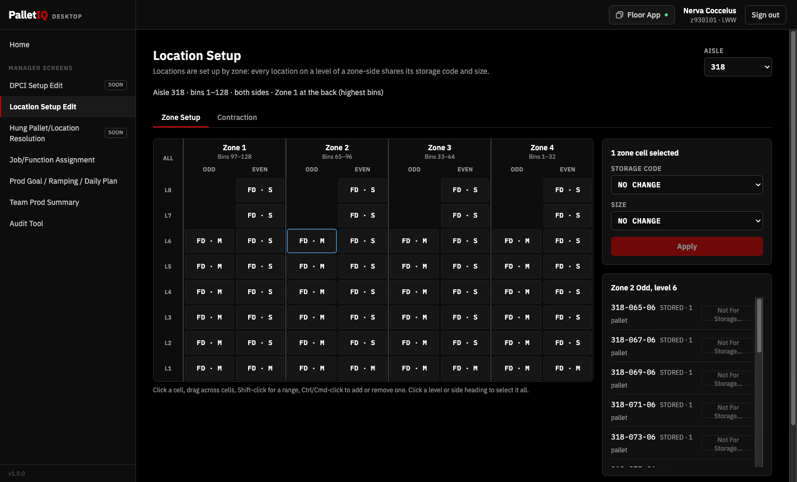 | 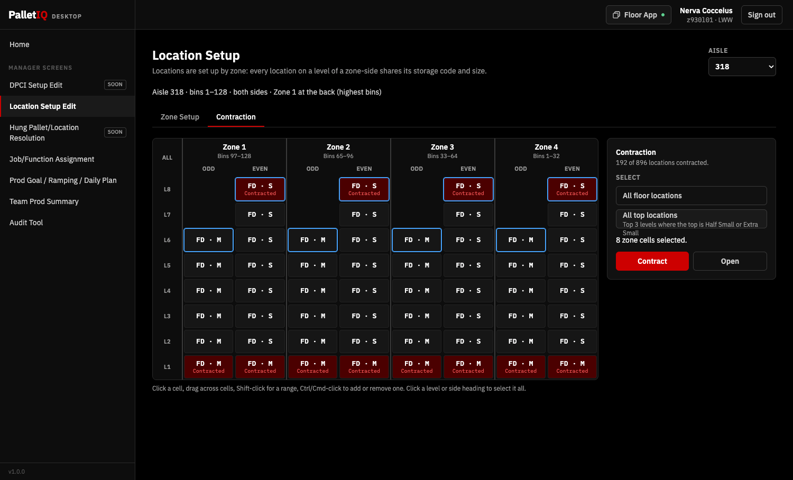 |
| **New aisle: zones, levels per side, and a live preview** | **Prod Goal / Ramping / Daily Plan: targets with the Daily Drop and staffing for reference** |
| 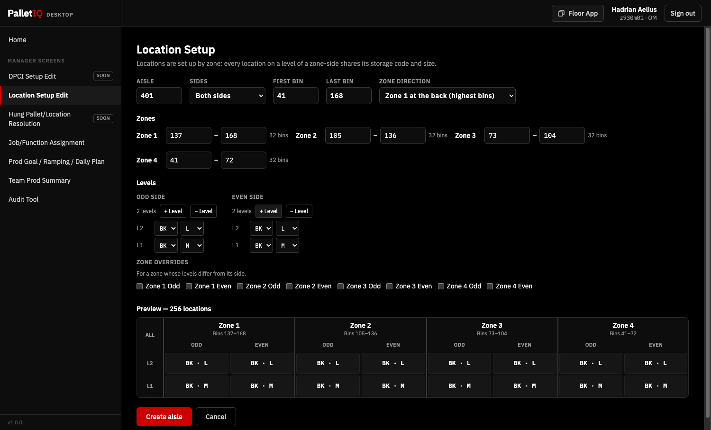 | 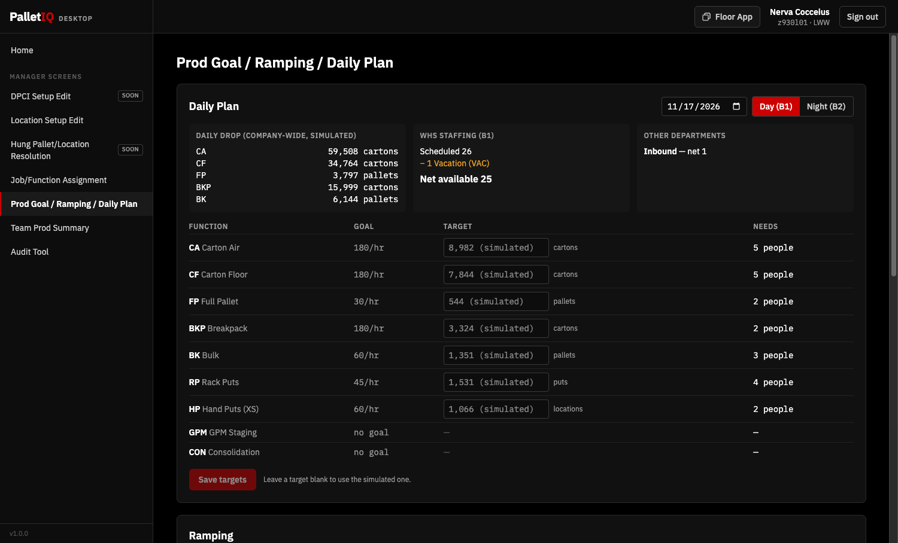 |
| **Audit Tool: three records side by side, linked by cross-reference chips** | **Embedded Floor App: the tablet app in a window, signed in from the desktop session** |
| 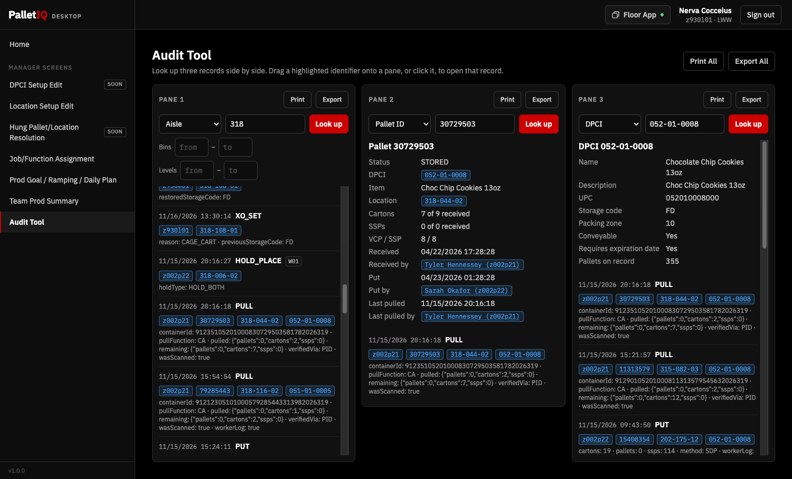 | 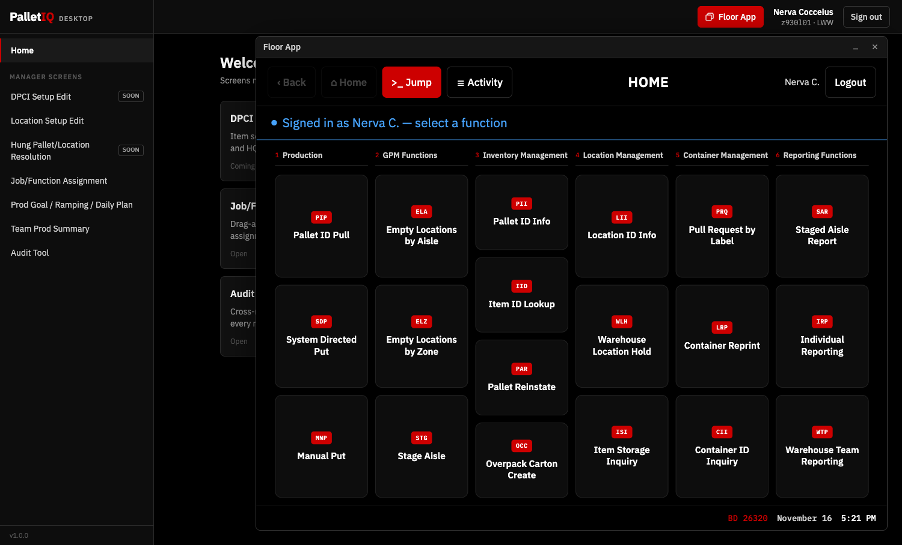 |
| **Home** | **Sign-in: zNumber and password** |
| 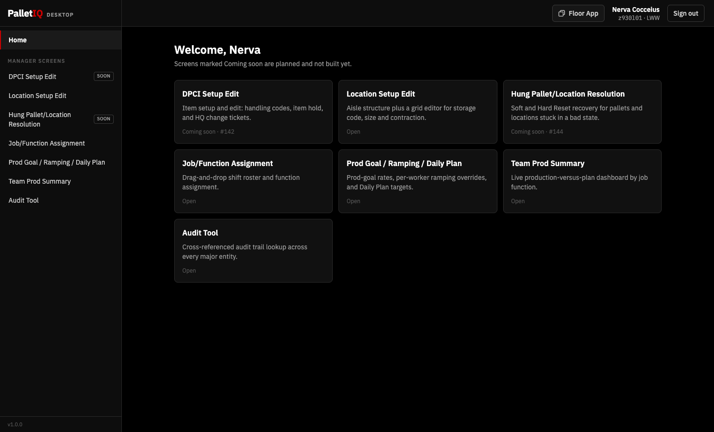 | 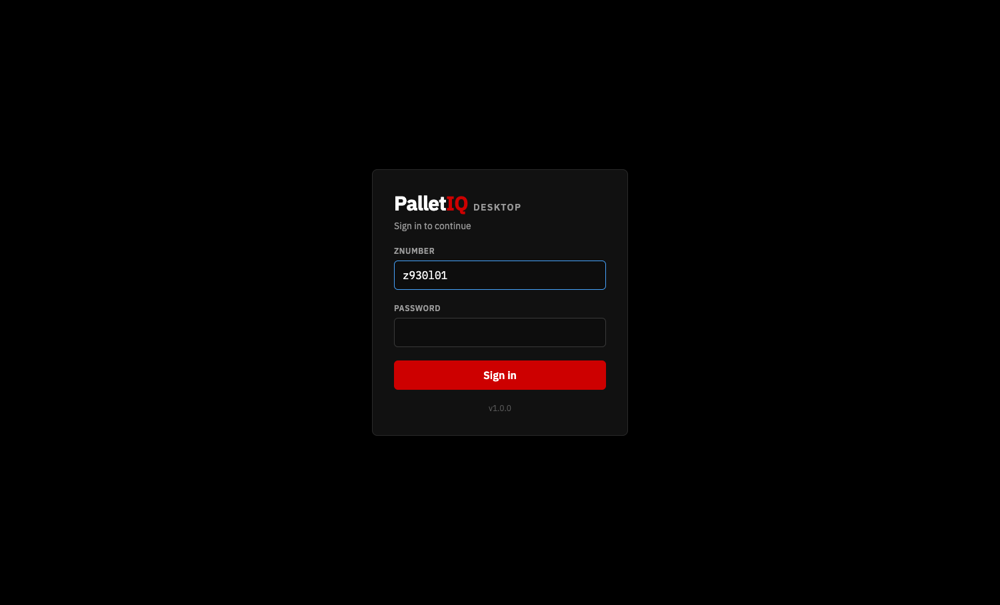 |

## Where things live

- **Design docs:** `../../DevNotes/DesignPrompts/Desktop/` — one file per screen, plus
  `Session-Log-2026-07-25.md` for the full design-session narrative.
- **GitHub issues:** filed under the `major-feature-addition` label — one umbrella issue
  for the whole v1.0.0 build, one child issue per screen.
- **Dev logs:** `../../DevNotes/Logs/Desktop/V1.0/` — session-by-session build record,
  same convention the other apps' `DevNotes/Logs/` trees use.

## Running it

```
npm install
npm run dev       # Vite dev server on :5174 + Electron pointed at it (HMR)
npm run dev:web   # renderer only, in a browser tab
npm start         # production build, served inside Electron over app://
npm run package   # unpacked electron-builder output in release/
```

The API has to be running (`cd ../../api && npm start`, port 7071). In development Vite
proxies `/api/*` to it; in a built app Electron's main process forwards `/api/*` to
`PALLETIQ_API_URL` (default `http://localhost:7071`).

## Signing in

`POST /api/auth/desktop-login` takes a zNumber and a password (`User.passwordHash`, a
second credential beside the tablet PIN). Only LEAD (shown as LWW), MANAGER (shown as
OM), ADMIN, or anyone whose home department is ICQA (`IQA`) may sign in; the rule lives
in `../../shared/roles.ts` (`isDesktopEligible`). Passwords are admin-set — there is no
self-service reset. The three eligible demo users (`z002p23`, `z002p24`, `z002p25`) are
seeded with the password `Desktop1234`.

The session is kept in `localStorage` and survives closing the app until the 12-hour
token expires.

## Embedded Floor App

The **Floor App** button in the header opens the floor app (`../floor-app`) in a window
inside the desktop app, already signed in as the desktop user — no badge or PIN. Typing
goes through the physical keyboard; the on-screen keypads are not shown. Minimizing or
closing the window only hides it, so reopening returns to the same screen and state;
signing out of the desktop app ends it.

It loads the floor app from `PALLETIQ_FLOOR_APP_URL` (default `http://localhost:5173`,
the floor app's dev server), so in development run `npm run dev` in `../floor-app` too.
Spec: `../../Documentation/ScreenSpecs/Desktop-Embedded-Floor-App.md`.

## Audit Tool

Three panes that each look up a Location, Pallet ID, DPCI, Container ID, zNumber or
Aisle and show its current state and history. Identifiers are chips: drag one onto a
pane, or click it and pick a pane, to open that record alongside. Each pane, and all
panes together, can be printed or exported to Excel. Read-only; served by
`GET /api/audit`. Spec: `../../Documentation/ScreenSpecs/Desktop-Audit-Tool.md`.

## Location Setup

Pick an aisle to see it as a grid of zone cells (one per level of each zone-side).
**Zone Setup** sets storage code and size by zone cell and marks single locations Not For
Storage; **Contraction** contracts or opens zone cells (floor / top presets) or single
locations. OM, ICQA and Admin can also create and delete aisles and restore Not For
Storage locations. Spec: `../../Documentation/ScreenSpecs/Desktop-Location-Setup.md`.

## Job/Function Assignment

The shift roster as a timeline, one bar per team member. Select names and click a
function in the sticky header to assign their unassigned time (a dialog handles anyone
already assigned). Drag a section's edge or type a start / finish time to change it;
click a section to edit it, double-click to split it. Downtime and Time Off take a reason.
LWW, OM and Admin only. Sign in as a Roman lead (e.g. `z930l01` / `Desktop1234`, B1) to
see a full roster. Spec: `../../Documentation/ScreenSpecs/Desktop-Job-Assignment.md`.

## Prod Goal / Ramping / Daily Plan

Daily Plan targets per function for a date and shift (with the Daily Drop, staffing and
other departments as reference), ramping overrides, and prod goal rates with dated
history. LWW, OM and Admin; goal rates are OM / Admin only. Spec:
`../../Documentation/ScreenSpecs/Desktop-Prod-Goal-Daily-Plan.md`.

## Team Prod Summary

Live production vs plan for a date and shift: a card per function with staffing, Team
Prod %, % to Plan and (pull functions) estimated finish; expand a card for each worker's
figures. Every desktop user. Spec: `../../Documentation/ScreenSpecs/Desktop-Team-Prod-Summary.md`.

## Tests

`npm run test:e2e` builds the app and runs the Playwright suite against the real local API
(35 tests, one spec per screen plus sign-in and the shell). The API must be running; the
Embedded Floor App spec also needs the floor app's dev server. See `tests/e2e/README.md`.

Manual testing: `../../Documentation/PalletIQ-Desktop-Manual-Checklist.html` (interactive,
open in a browser) or the printable `.docx` beside it — one page per screen, same format as
the floor app's checklist. Both are generated by `../../Documentation/gen_desktop_checklist.py`.

## Not yet done

- DPCI Setup Edit (#142) and Hung Pallet/Location Resolution (#144) do not exist yet; their
  nav entries open a "Coming Soon" page.
- None of the ~15 new Prisma models these screens need have been added to
  `../../api/prisma/schema.prisma` yet.
